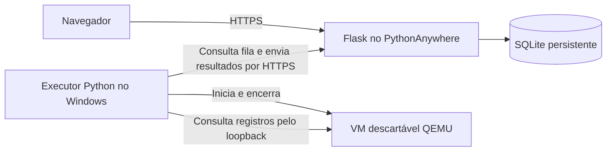

# Purple Talent — Recrutamento e prática em cibersegurança

<p align="center">
  
</p>

<p align="center">
  
  
  
  
</p>

<p align="center">
  <a href="https://brenooliveira123.pythonanywhere.com/">Site publicado</a> ·
  <a href="#executar-no-windows">Executar no Windows</a> ·
  <a href="#documentação">Documentação</a>
</p>

---

## O que é o Purple Talent?

O **Purple Talent** reúne desafios de cibersegurança, candidaturas e avaliação de competências. O participante pratica análise de evidências em desafios Capture The Flag (CTF). Ao se candidatar a uma vaga, responde a um questionário específico e pode realizar um estudo de caso que a mentoria revisa.

O projeto foi desenvolvido no **Projeto Saga SENAI**, na **Escola SENAI A. Jacob Lafer**, no contexto do programa de talentos da CTI Brasil. A proposta é dar aos participantes espaço para demonstrar como investigam problemas, justificam decisões e comunicam resultados.

> **Prática para aprender. Evidências para conversar. Pessoas para decidir.**

---

## O que ele entrega?

### Para candidatos

- Busca de vagas por cargo, área de atuação e modalidade de trabalho.
- Questionários por vaga com seleção única, múltipla seleção, texto curto, resposta discursiva, número e URL.
- Rascunho, revisão antes do envio, acompanhamento de etapa, devolutiva e extrato da candidatura.
- Desafios individuais nas trilhas Red Team, Blue Team, Aquecimento e Corporativo, além de atividades colaborativas quando a mentoria exige equipe.
- Ranking, histórico de progresso e laboratórios individuais com fila e tempo de uso.

### Para a mentoria

- Criação, edição e publicação de vagas, com prazo, pausa, reabertura e encerramento.
- Editor de perguntas por vaga, com gabarito opcional para escolha única e versões que preservam o formulário de cada inscrição.
- Busca de candidaturas por vaga, etapa e situação da avaliação.
- Dossiê com respostas, evidências, rubrica de competências, parecer privado e devolutiva compartilhável.
- Gestão de conteúdo, desafios, equipes e fila de ambientes virtuais.

---

## Como funciona?

1. **Candidatura.** A pessoa escolhe uma vaga, preenche o formulário e revisa as respostas antes de enviar. O sistema vincula a inscrição à versão do questionário utilizada.
2. **Avaliação.** A candidatura pode incluir um cenário textual de SOC ou AppSec, com etapas de investigação, análise de evidências e parecer técnico.
3. **Revisão.** A mentoria avalia o trabalho, registra a justificativa e decide a próxima etapa. Os pontos da arena permanecem separados da avaliação da candidatura.
4. **Laboratório.** Na arena, a pessoa pode reservar a Intranet esquecida ou o Incidente em andamento. O executor inicia a VM pela ordem da fila. O período de 60 minutos começa quando ela está pronta.

## Visão da plataforma

<p align="center">
  
  
</p>

*Capturas da aplicação com dados fictícios.* [Origem das imagens](docs/IMAGENS-APRESENTACAO.md)

---

## Arquitetura



O site publicado mantém o banco de candidatos e da fila na hospedagem. O executor Windows atende uma VM por vez e faz conexões de saída para consultar o site. Mudar o computador do executor preserva o endereço público e a base de recrutamento. [Guia de migração](docs/MIGRAR-SERVIDOR-WINDOWS.md)

| Camada | Tecnologia |
| --- | --- |
| Interface | HTML, Jinja, CSS e JavaScript |
| Aplicação | Python 3.12 e Flask 3.1 |
| Persistência | SQLite |
| Hospedagem do site | PythonAnywhere, via WSGI |
| Laboratórios publicados | QEMU com convidado Ubuntu 24.04 e executor Python |
| Verificação | unittest e roteiros de navegador com Playwright |

### Rotas principais

| Acesso | Rota | Finalidade |
| --- | --- | --- |
| Público | `/opportunities` | Consultar vagas abertas |
| Participante | `/my-applications` | Retomar ou acompanhar candidaturas |
| Participante | `/challenges` | Abrir desafios e entrar na fila de laboratório |
| Participante | `/teams` | Criar equipe ou ingressar em uma equipe disponível |
| Participante | `/ranking` | Consultar classificação da arena |
| Mentoria | `/admin` | Gerir vagas e revisar candidaturas |
| Mentoria | `/admin/challenges` | Criar e editar desafios |
| Mentoria | `/ambientes` | Acompanhar a fila e as VMs |

---

## Proteções e operação

| Área | Controle |
| --- | --- |
| Sessão e formulários | Cookies de sessão com HttpOnly e SameSite, atributo Secure em produção, proteção CSRF e limites de requisição |
| Permissões | Rotas de mentoria restritas, controle de acesso por titularidade para candidaturas e laboratórios |
| Questionários | Versões por inscrição, controle de edição simultânea e gabarito disponível à mentoria |
| VMs | Execução descartável em QEMU, rede restrita, acesso mediado pelo executor e expiração da sessão |
| Dados | Backup e restauração do SQLite para arquivos novos, com verificação de integridade |

Use dados fictícios na demonstração. Antes de abrir uma seletiva com dados reais, valide HTTPS obrigatório, operação dos laboratórios, restauração de backup e regras de acesso no ambiente de uso. [Revisão de segurança](docs/SEGURANCA-FINAL.md)

---

## Executar no Windows

Pré-requisitos para a aplicação local: **Git, Python 3.12 e PowerShell**. O modo de demonstração da jornada de recrutamento dispensa Docker e máquinas virtuais.

```powershell
git clone https://github.com/Breno-J-Oliveira/CTI-PurpleTalent.git
Set-Location CTI-PurpleTalent
py -3.12 -m venv .venv
.\.venv\Scripts\python.exe -m pip install -r requirements.txt
powershell.exe -NoProfile -ExecutionPolicy Bypass -File .\scripts\run_local.ps1 -Demo -Port 5057
```

Abra a [demonstração local](http://127.0.0.1:5057). A primeira execução cria uma base separada com vagas, respostas e avaliações fictícias. Execuções seguintes retomam a mesma base.

| Acesso da demo local | E-mail | Senha de demonstração |
| --- | --- | --- |
| Candidato | `candidato@demo.invalid` | `demonstracao123` |
| Mentoria | `mentor@cti.local` | `mentor123` |

A senha demonstrativa de mentoria vale apenas para uma base recém-criada sem `MENTOR_PASSWORD` personalizada. Consulte o [roteiro de apresentação](docs/APRESENTACAO.md) para percorrer a demonstração.

Para executar a cópia local de trabalho, remova `-Demo` e use a porta padrão. O launcher permite selecionar outra base com `-Database`.

```powershell
powershell.exe -NoProfile -ExecutionPolicy Bypass -File .\scripts\run_local.ps1
```

Para preparar o executor QEMU, siga o [guia de migração do servidor](docs/MIGRAR-SERVIDOR-WINDOWS.md). Para publicar o site, siga o [guia do PythonAnywhere](docs/HOSPEDAGEM.md).

## Testes

```powershell
.\.venv\Scripts\python.exe -m unittest discover -s tests -v
```

A suíte usa bancos temporários para verificar as regras da aplicação. A validação de boot real usa o runtime e os cenários descritos no [guia de laboratórios remotos](docs/PREPARACAO-VM-REMOTA.md).

---

## Documentação

| Documento | Conteúdo |
| --- | --- |
| [Documentação da equipe](docs/documentacao-equipe/README.md) | Objetivo, requisitos, protótipo e referências do Projeto Saga |
| [Roteiro de apresentação](docs/APRESENTACAO.md) | Demonstração da jornada do candidato e da mentoria |
| [Gestão de vagas](docs/ENTREGA-GESTAO-VAGAS.md) | Publicação, prazo, pausa e encerramento |
| [Recrutamento e avaliação](docs/ENTREGA-RECRUTAMENTO.md) | Formulários, candidaturas e avaliação por etapas |
| [Rubrica de avaliação](docs/ENTREGA-RUBRICA.md) | Competências e histórico do parecer |
| [Hospedagem](docs/HOSPEDAGEM.md) | Configuração do site e persistência do banco |
| [Troca do computador servidor](docs/MIGRAR-SERVIDOR-WINDOWS.md) | Instalação do executor, cópia do runtime e retorno ao computador anterior |
| [Laboratórios remotos](docs/PREPARACAO-VM-REMOTA.md) | QEMU, fila, desligamento e diagnóstico |
| [Plano de testes de software](docs/Plano%20de%20Testes%20de%20Software%20%26%20GOT.docx) | Matriz de cenários e registros de verificação |
| [Histórico de mudanças](docs/mudanca.md) | Alterações e integrações do projeto |

## Equipe

Projeto desenvolvido na **Escola SENAI A. Jacob Lafer**.

| Integrante | Responsabilidade |
| --- | --- |
| Ana Carolina | Desenvolvimento |
| Breno José | Desenvolvimento |
| João Pedro Tomazini | Desenvolvimento |
| Leonardo Alves | Desenvolvimento |
| Nicolas Tukaze | Desenvolvimento |
| Paolla Veronêz | Product Owner |
| Rafaela Oliveira | Scrum Master |
